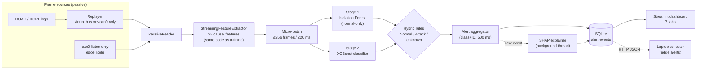

# CAN Bus Intrusion Detection System

**ML-Based Security Framework for In-Vehicle (CAN Bus) Networks**


-brightgreen)
-brightgreen)


B.Tech CSE Major Project · Dev Bhoomi Uttarakhand University (DBUU), Dehradun ·
School of Engineering and Computing, Department of CSE · Batch 2026–2027

> ⚠️ **Safety notice.** This is an academic, **passive, defensive** research prototype. It uses
> public datasets and isolated virtual CAN only (python-can `virtual` bus or Linux `vcan0`).
> - The replayer **refuses any physical interface**.
> - The live reader has **no send path**.
> - The edge runner **refuses to open a physical bus unless the kernel reports listen-only mode**.
>
> It is **not** a certified automotive safety system and is never connected to, or used to
> control, a road-going vehicle.

---

## 1. What it does

CAN (ISO 11898-1) has no sender authentication, so any node can inject frames. This project builds
an explainable, real-time IDS:

1. **Streaming features.** One implementation computes 25 causal features per frame: payload,
   timing and rolling-window statistics. It is used both for training and live.
2. **Stage 1: anomaly detection.** An Isolation Forest is trained on normal traffic only.
3. **Stage 2: attack classifier.** XGBoost (selected against RandomForest) labels Normal, DoS, Fuzzy
   or Spoofing.
4. **Hybrid decision.** If stage 1 fires but the classifier cannot name an attack, the frame
   becomes **Unknown / Suspicious** instead of being forced into a label.
5. **SHAP explanations**, burst-aggregated **alerts** in SQLite, a **Streamlit dashboard**, and a
   headless **edge runner** (Raspberry Pi ready).

**Research question.** Can a hybrid pipeline (anomaly detector plus classifier) balance detecting
unusual traffic with interpretable attack categories, while keeping false positives low and latency
practical? See §4 for the answer we found on ROAD.

## 2. Architecture



Offline path: `build_dataset.py` (unified schema) → `build_features.py` (cleaning, leakage-safe
splits, per-ID statistics fitted on training data only) → `train.py` (validation-only tuning) →
`evaluate.py` / `ablation.py` / `error_analysis.py` (test split, every access logged).

## 3. Quick start

Requires **Python 3.11**. The repository ships the trained ROAD models (about 2.6 MB) and small
ROAD demo logs (`data/demo/`, about 3 MB), so the demo works **without downloading any dataset**.

**Windows (PowerShell)**
```powershell
py -3.11 -m venv .venv
.\.venv\Scripts\Activate.ps1
pip install -r requirements-dev.txt
pip install -e .
pytest
streamlit run app/dashboard.py
```

**Linux**
```bash
python3.11 -m venv .venv && source .venv/bin/activate
pip install -r requirements-dev.txt && pip install -e .
pytest
streamlit run app/dashboard.py
```

In the dashboard's **Live Monitor** tab, pick `demo/road_max_speedometer_attack_3.parquet`, choose a
speed and press **Start**. Alerts, explanations and the replayed ground truth appear live.

Other ways to run it:

| Goal | Command |
|---|---|
| Headless live demo | `python scripts/run_realtime.py --file data/demo/road_fuzzing_attack_3.parquet --speed 5` |
| Linux, through `vcan0` | `bash scripts/replay_demo.sh` |
| Docker | `docker build -t can-ids .` then `docker run --rm -p 8501:8501 can-ids` |
| Edge node (Pi / Linux) | see [deploy/raspberry_pi/README.md](deploy/raspberry_pi/README.md) |

> The Docker image was **not built on the development machine** (Docker was not installed). Its
> contents were validated by running the demo from an isolated copy of exactly the files the
> Dockerfile copies.

### Public demo link (Streamlit Community Cloud, free)

The repository is deploy-ready: the trained models, saved results and demo logs are committed,
and the dashboard imports `canids` from `src/` when the package is not pip-installed.

1. Push this repository to GitHub.
2. Go to **https://share.streamlit.io**, sign in with GitHub and click **Create app**.
3. Choose your repository, branch `master`, main file path `app/dashboard.py`.
4. Under **Advanced settings**, pick **Python 3.11**. Then click **Deploy**. The first build
   installs `requirements.txt` and takes a few minutes.
5. Share the resulting `https://<name>.streamlit.app` link. It opens on any phone or laptop.

On the hosted app, replay uses the in-process virtual bus. Alerts are stored in a temporary
SQLite file, which resets when the app restarts. Free apps sleep after a period without visitors
and wake up on the next visit.

## 4. Results (ROAD, held-out test set, 6,121,249 frames, 24,510 attack frames)

Full tables, figures and the test-access audit log: **[reports/RESULTS.md](reports/RESULTS.md)**.
Interpretation: [reports/phase7_summary.md](reports/phase7_summary.md).

| System | Alarm precision | Detection recall | Alarm FPR | Macro-F1 |
|---|---|---|---|---|
| Rule baseline | 0.018 | 0.033 | 0.0070 | n/a |
| Isolation Forest only | 0.021 | 0.122 | 0.0233 | n/a |
| XGBoost classifier only | 0.701 | 0.668 | 0.0011 | 0.881 |
| **Hybrid (tuned)** | 0.699 | 0.642 | **0.0011** | **0.886** |

**Key findings**
- **The supervised stage makes the IDS usable.** Stage 1 alone produces about 50 false alarms
  per true alarm.
- **Hybrid answer on ROAD: negative for stage 1.** Removing the Isolation Forest changes nothing
  measurable, and letting it raise Unknown adds about 142k false alarms.
- **Timing features catch fabrication attacks (≈99.8% without payload features), and payload
  features catch masquerade attacks.** Neither group does both.
- **Part of the payload signal is spurious.** SHAP, the error analysis and the false-positive
  distribution all point at a vehicle-state byte. That was caught because whole recordings were
  held out for testing.
- **The unseen-target attack (coolant temperature) is missed by every variant.**
- **Real time.** On an AMD Ryzen 5 7520U laptop: 16,573 frames/s for the pipeline and 10,655
  frames/s end to end (p95 latency 16.5 / 20.9 ms). A 500 kbit/s bus carries ≤ 4,505 frames/s of
  8-byte frames.

## 5. Reproduce everything

The raw datasets are not in the repository. See [scripts/download_data.md](scripts/download_data.md)
(ROAD from Zenodo, CC BY 4.0; HCRL from its lab page). The full pipeline, in order:

```bash
python scripts/build_dataset.py --checksums
python scripts/verify_road_labels.py
python scripts/build_features.py --dataset road
python scripts/verify_features.py --dataset road
python scripts/train.py anomaly --dataset road
python scripts/train.py hybrid --dataset road
python scripts/evaluate.py anomaly --dataset road
python scripts/evaluate.py hybrid --dataset road
python scripts/explain.py --dataset road
python scripts/ablation.py --dataset road
python scripts/error_analysis.py --dataset road
python scripts/benchmark.py --dataset road --frames 1000000
python scripts/cross_dataset.py
python scripts/make_results.py
```

These are also wrapped in `scripts/reproduce.ps1` and `scripts/reproduce.sh`. `cross_dataset.py`
needs both datasets processed. Seeds, splits and thresholds come from `configs/*.yaml`. Every model
directory carries a metadata JSON (feature version, parameters, date, git commit).

## 6. Repository map

```
configs/        data.yaml, model.yaml, app.yaml - every tunable value, with rationale comments
src/canids/
  ingestion/    unified schema, HCRL + ROAD loaders, safe replayer, passive reader
  preprocessing/cleaning, leakage-safe splits, streaming features, dataset loader
  models/       Isolation Forest, rule baseline, RF/XGBoost classifier, hybrid rules
  explain/      TreeSHAP explainer (shap package or XGBoost native backend)
  alerting/     Alert + aggregation + severity, SQLite store
  evaluation/   metrics, ablation, cross-dataset, runtime helpers
  pipeline/     real-time pipeline, monitor session, edge helpers
  utils/        config, logging, seeding, provenance
app/dashboard.py   Streamlit UI (7 tabs)
scripts/           every pipeline step + demo, benchmark, edge runner, collector
models/road/       trained models + metadata (committed)
data/demo/         small ROAD excerpts for demos (CC BY 4.0, committed)
reports/           RESULTS.md, phase summaries, feature dictionary, results/, figures/
deploy/raspberry_pi/  edge setup guide (listen-only), bundle export target
docs/              3-minute demo script
tests/             226 tests (unit + integration), 92% line coverage on src/
```

## 7. Limitations (honest list)

- **Only ROAD was evaluated.** The HCRL files were not available on the evaluation machine, so DoS,
  within-HCRL and cross-dataset results are **not run**. The code is ready (`cross_dataset.py`).
  ROAD has no DoS class, and its accelerator captures are excluded (no labels).
- **One vehicle, 3 recordings per attack type** (1 for coolant). There are 114 Fuzzy test frames.
- **Labels come from metadata injection intervals**, with small noise at interval edges.
- **Frame-level evaluation only.** Cold-start alerts (the first frame of an ID) are not suppressed.
- **The optional LSTM was not implemented.** The Raspberry Pi benchmark was not run (no hardware;
  the software and guide are ready).
- On the development laptop, Windows Application Control blocks the `shap` package's numba DLL.
  Explanations therefore use XGBoost's built-in exact TreeSHAP, which gives identical attributions.

## 8. Safety and ethics

- **Passive by design.** No component sends frames to a physical bus. The only transmitting
  component (the replayer) is restricted in code to the python-can `virtual` bus or `vcan*`. The edge
  runner verifies listen-only mode through the kernel before reading a physical interface.
- **Public data only.** ROAD (CC BY 4.0) and HCRL (academic use) data are used under their terms.
  Only small ROAD excerpts are redistributed, with attribution.
- **Not a safety product.** Detection results are research measurements on recorded data, not
  guarantees for any vehicle.
- **SHAP explanations show model attribution, not causal proof.**

## 9. Datasets and citations

- H. M. Song, J. Woo, H. K. Kim, "In-vehicle network intrusion detection using deep convolutional
  neural network," *Vehicular Communications*, vol. 21, 100198, 2020. (HCRL Car-Hacking Dataset)
- E. Seo, H. M. Song, H. K. Kim, "GIDS: GAN based Intrusion Detection System for In-Vehicle
  Network," *PST 2018*, IEEE (corrected version: arXiv:1907.07377).
- M. E. Verma et al., "A comprehensive guide to CAN IDS data and introduction of the ROAD
  dataset," *PLoS ONE* 19(1): e0296879, 2024. Data: https://doi.org/10.5281/zenodo.10462796
  (CC BY 4.0).

## 10. Team

| Name | Roll No. | Main responsibilities |
|---|---|---|
| Uma Shankar | 23BTCSE0162 | real-time pipeline, dashboard, Docker, edge deployment |
| Priyanshu Raj | 23BTCSE0300 | ingestion, features, models, explainability |
| Ruby Kumari | 23BTCSE0068 | EDA, evaluation, report, presentation |

**Supervisor:** Mr. Deepak Pathak
