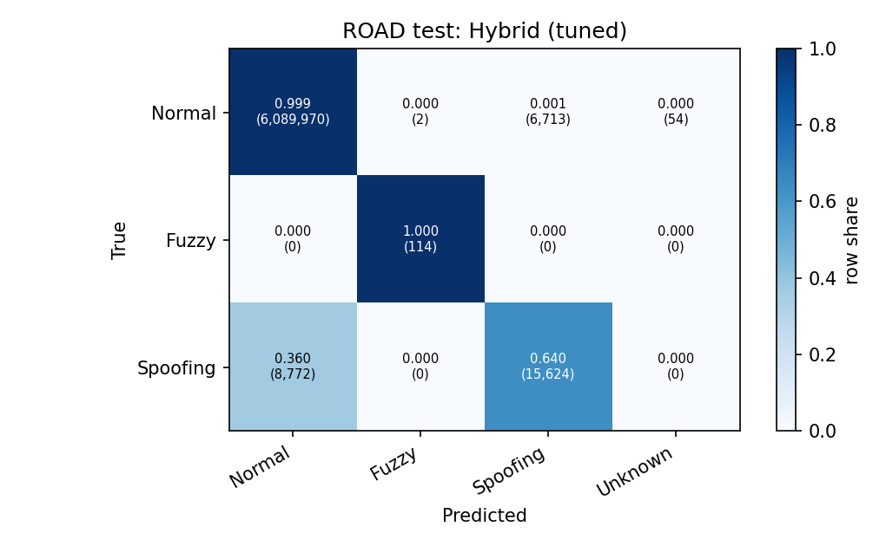
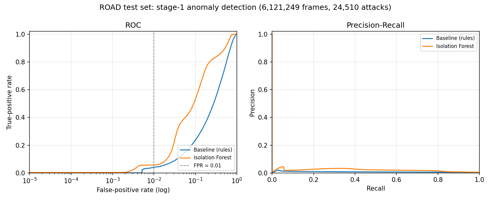
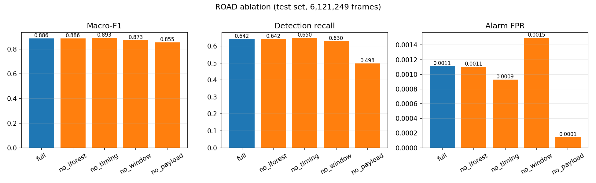
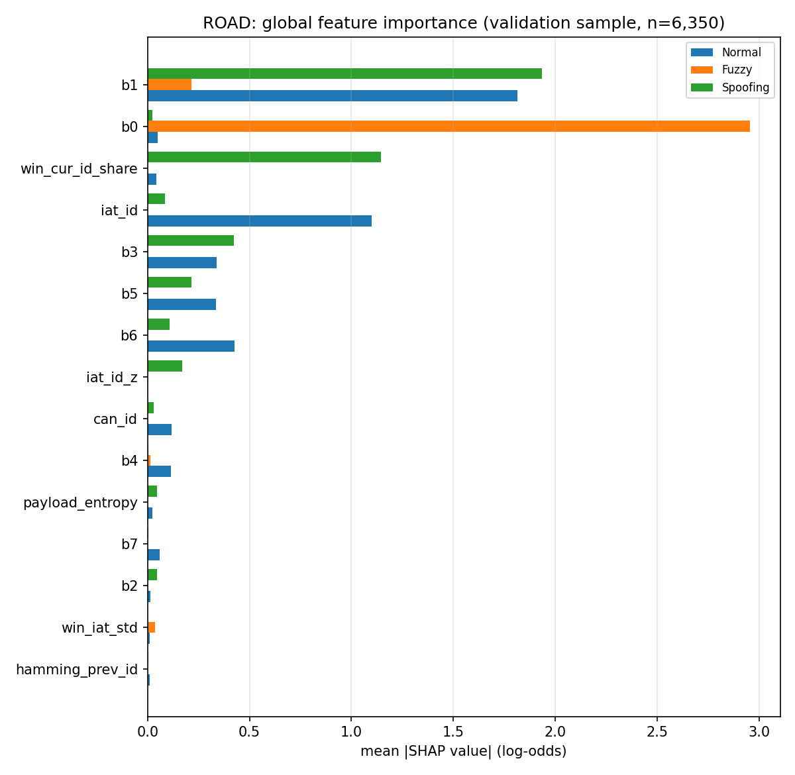

# RESULTS

Generated by `scripts/make_results.py` on 2026-11-11 (git: `uncommitted`). Every number below is read from `reports/results/`; experiments without result files are marked **Not run**.

## 1. Datasets

| dataset | Fuzzy | Normal | Spoofing | total |
|---|---|---|---|---|
| road | 1,055 | 27,353,470 | 61,458 | 27,415,983 |

> **Not run:** HCRL ingestion, within-HCRL experiments and DoS evaluation. Reason: the HCRL raw files are not available on the evaluation machine (data/raw/hcrl/ is empty); the pipeline is ready and runs with the same commands.

ROAD has no DoS attack class; ROAD accelerator captures are excluded (labels not disclosed by the dataset authors).

**ROAD splits** (ambient: chronological 60/20/20 per capture with 100-frame purge; attack captures: whole recordings `_1` train / `_2` val / `_3` test; coolant capture test-only).

| split | Normal | Spoofing | Fuzzy | total | attack_share_pct |
|---|---|---|---|---|---|
| train | 15,144,362 | 14,386 | 591 | 15,159,339 | 0.0988 |
| val | 6,108,534 | 22,676 | 350 | 6,131,560 | 0.3755 |
| test | 6,096,739 | 24,396 | 114 | 6,121,249 | 0.4004 |
| purged | 2,400 | 0 | 0 | 2,400 | 0.0000 |

Leakage check: **passed** on 41 files.

## 2. Within-dataset results: ROAD (held-out test set)

### 2.1 Baseline vs Isolation Forest vs Classifier vs Hybrid

| system | alarm_precision | detection_recall | binary_f1 | alarm_fpr | roc_auc | pr_auc | macro_f1 | weighted_f1 | unknown_on_attacks | unknown_on_normal |
|---|---|---|---|---|---|---|---|---|---|---|
| Baseline (rules) | 0.0184 | 0.0325 | 0.0235 | 0.0070 | 0.6758 | 0.0076 |  |  |  |  |
| Isolation Forest only | 0.0207 | 0.1224 | 0.0354 | 0.0233 | 0.8396 | 0.0205 |  |  |  |  |
| Classifier only (xgboost) | 0.7005 | 0.6677 | 0.6837 | 0.0011 | 0.9038 | 0.6997 | 0.8810 | 0.9975 |  |  |
| Hybrid (tuned) | 0.6992 | 0.6421 | 0.6695 | 0.0011 |  |  | 0.8862 | 0.9974 | 0 | 54 |
| Hybrid (no overrule, rules 1/2/4/5) | 0.0977 | 0.6567 | 0.1701 | 0.0244 |  |  | 0.8823 | 0.9857 | 358 | 141,951 |

Test set: 6,121,249 frames, 24,510 attack frames. Hybrid thresholds: `{'t_normal': 0.9, 't_attack': 0.6, 't_suppress': 0.5}`.

**Per-class (Classifier only (xgboost))**

| class | precision | recall | f1 | support |
|---|---|---|---|---|
| Normal | 0.9987 | 0.9989 | 0.9988 | 6,096,739 |
| Fuzzy | 0.9268 | 1.0000 | 0.9620 | 114 |
| Spoofing | 0.6993 | 0.6661 | 0.6823 | 24,396 |

**Per-class (Hybrid (tuned))**

| class | precision | recall | f1 | support |
|---|---|---|---|---|
| Normal | 0.9986 | 0.9989 | 0.9987 | 6,096,739 |
| Fuzzy | 0.9828 | 1.0000 | 0.9913 | 114 |
| Spoofing | 0.6995 | 0.6404 | 0.6686 | 24,396 |

### 2.2 Detection rate by attack type

| group | Baseline (rules) | Classifier only (xgboost) | Hybrid (no overrule, rules 1/2/4/5) | Hybrid (tuned) | Isolation Forest only |
|---|---|---|---|---|---|
| correlated_signal | 0.0245 | 1.0000 | 1.0000 | 1.0000 | 1.0000 |
| correlated_signal_masquerade | 0.0000 | 1.0000 | 1.0000 | 1.0000 | 0.1211 |
| fuzzing | 0.9649 | 1.0000 | 1.0000 | 1.0000 | 1.0000 |
| max_engine_coolant_temp | 0.3023 | 0.0000 | 0.0000 | 0.0000 | 0.0000 |
| max_engine_coolant_temp_masquerade | 0.0233 | 0.0000 | 0.0000 | 0.0000 | 0.0000 |
| max_speedometer | 0.0519 | 0.7200 | 0.7785 | 0.7200 | 0.2335 |
| max_speedometer_masquerade | 0.0000 | 0.7193 | 0.7195 | 0.7193 | 0.0057 |
| reverse_light | 0.0679 | 0.6242 | 0.5171 | 0.5171 | 0.0013 |
| reverse_light_masquerade | 0.0000 | 0.4070 | 0.3829 | 0.3829 | 0.0000 |

*Hybrid confusion matrix (ROAD test)*

*Stage-1 ROC / PR curves (ROAD test)*

### 2.3 Stage-1 false-positive rate by context

| model | group | frames | false_positives | fpr |
|---|---|---|---|---|
| Baseline (rules) | ambient capture | 4,891,861 | 33,607 | 0.00687 |
| Baseline (rules) | normal frames in attack capture | 1,204,878 | 8,935 | 0.00742 |
| Isolation Forest | ambient capture | 4,891,861 | 124,042 | 0.02536 |
| Isolation Forest | normal frames in attack capture | 1,204,878 | 17,918 | 0.01487 |

## 3. Cross-dataset results

> **Not run:** HCRL->ROAD and ROAD->HCRL transfer. Reason: the HCRL raw files are not available on the evaluation machine (data/raw/hcrl/ is empty); the pipeline is ready and runs with the same commands.

Prepared protocol (`scripts/cross_dataset.py`): common vehicle-agnostic features only (timing, window statistics, payload entropy, Hamming distance; CAN ID, payload bytes, DLC, known-ID and per-ID z-score dropped), labels {Normal, Fuzzy, Spoofing} plus binary Normal-vs-Attack, within-source reference with the same features.

## 4. Ablation (ROAD test)

Fixed Phase 3/4 hyperparameters; each variant refit on the same seeded samples and its thresholds re-tuned on validation.

| variant | macro_f1 | weighted_f1 | f1_Normal | f1_Fuzzy | f1_Spoofing | detection_recall | alarm_fpr | alarm_precision | binary_f1 | unknown_frames | n_features | t_attack | t_suppress |
|---|---|---|---|---|---|---|---|---|---|---|---|---|---|
| full | 0.8862 | 0.9974 | 0.9987 | 0.9913 | 0.6686 | 0.6421 | 0.0011 | 0.6992 | 0.6695 | 54 | 25 | 0.6000 | 0.5000 |
| no_iforest | 0.8862 | 0.9974 | 0.9987 | 0.9913 | 0.6686 | 0.6421 | 0.0011 | 0.7009 | 0.6702 | 0 | 25 | 0.6000 | 1.0100 |
| no_timing | 0.8934 | 0.9976 | 0.9988 | 0.9913 | 0.6901 | 0.6497 | 0.0009 | 0.7374 | 0.6908 | 63 | 22 | 0.8000 | 0.8000 |
| no_window | 0.8727 | 0.9970 | 0.9985 | 0.9913 | 0.6282 | 0.6298 | 0.0015 | 0.6281 | 0.6290 | 72 | 16 | 0.8000 | 0.5000 |
| no_payload | 0.8545 | 0.9976 | 0.9989 | 0.9048 | 0.6598 | 0.4982 | 0.0001 | 0.9333 | 0.6496 | 677 | 15 | 0.9900 | 0.5000 |

| attack_type | full | no_iforest | no_payload | no_timing | no_window |
|---|---|---|---|---|---|
| correlated_signal | 1.0000 | 1.0000 | 0.9771 | 1.0000 | 1.0000 |
| correlated_signal_masquerade | 1.0000 | 1.0000 | 0.0000 | 1.0000 | 1.0000 |
| fuzzing | 1.0000 | 1.0000 | 0.8421 | 1.0000 | 1.0000 |
| max_engine_coolant_temp | 0.0000 | 0.0000 | 0.0000 | 0.0000 | 0.0000 |
| max_engine_coolant_temp_masquerade | 0.0000 | 0.0000 | 0.0000 | 0.0000 | 0.0000 |
| max_speedometer | 0.7200 | 0.7200 | 0.9984 | 0.7193 | 0.7200 |
| max_speedometer_masquerade | 0.7193 | 0.7193 | 0.0002 | 0.7193 | 0.7161 |
| reverse_light | 0.5171 | 0.5171 | 0.9983 | 0.5088 | 0.5171 |
| reverse_light_masquerade | 0.3829 | 0.3829 | 0.0010 | 0.4310 | 0.3242 |

*Ablation on the ROAD test set*

## 5. Explainability (ROAD validation)

Top-10 features by mean |SHAP| (log-odds):

| feature | Normal | Fuzzy | Spoofing | mean_all_classes |
|---|---|---|---|---|
| b1 | 1.8152 | 0.2150 | 1.9342 | 1.3215 |
| b0 | 0.0496 | 2.9560 | 0.0238 | 1.0098 |
| win_cur_id_share | 0.0422 | 0.0000 | 1.1457 | 0.3960 |
| iat_id | 1.1008 | 0.0000 | 0.0859 | 0.3956 |
| b3 | 0.3388 | 0.0000 | 0.4245 | 0.2544 |
| b5 | 0.3345 | 0.0000 | 0.2141 | 0.1829 |
| b6 | 0.4259 | 0.0000 | 0.1084 | 0.1781 |
| iat_id_z | 0.0019 | 0.0000 | 0.1692 | 0.0570 |
| can_id | 0.1181 | 0.0000 | 0.0296 | 0.0492 |
| b4 | 0.1144 | 0.0133 | 0.0046 | 0.0441 |

| case | true | predicted | p | reason |
|---|---|---|---|---|
| fuzzy | Fuzzy | Fuzzy | 0.998 | payload byte 0 = 0xFF and payload byte 4 = 0xFF -> Fuzzy-like |
| spoofing_fabrication | Spoofing | Spoofing | 0.998 | this ID is 0.08 of the last 100 frames and payload byte 1 = 0x71 -> Spoofing-like |
| spoofing_masquerade | Spoofing | Spoofing | 0.993 | this ID is 0.04 of the last 100 frames and payload byte 1 = 0x71 -> Spoofing-like |
| false_alarm | Normal | Spoofing | 0.994 | this ID is 0.05 of the last 100 frames and payload byte 1 = 0x73 -> Spoofing-like |

SHAP backend: xgboost native TreeSHAP (pred_contribs). SHAP values show which features the model relied on (attribution), not proof of what caused the attack.

Explanation latency: p50 9.97 ms, p95 11.05 ms, p99 30.04 ms, max 145.27 ms (budget 50 ms).

*Global SHAP importance*

## 6. Runtime and resources

Hardware: **AMD Ryzen 5 7520U with Radeon Graphics**, 8 logical CPUs, 15.3 GB RAM, Windows 11 (build 10.0.26300), Python 3.11.9. Input: 1,000,000 frames.

| scenario | frames | throughput_fps | p50_ms | p95_ms | p99_ms | max_ms | cpu_percent | peak_rss_mb |
|---|---|---|---|---|---|---|---|---|
| pipeline | 1,000,000 | 16,573.17 | 13.69 | 16.49 | 19.12 | 24.20 | 732.09 | 944.29 |
| pipeline_inline_shap | 1,000,000 | 13,687.73 | 14.48 | 18.09 | 22.70 | 52.78 | 575.87 | 952.20 |
| pipeline_batch1_5k | 5,000 | 132.53 | 6.49 | 12.23 | 26.33 | 631.62 | 537.81 | 952.15 |
| pipeline_batch256_5k | 5,000 | 11,794.27 | 14.79 | 25.95 | 39.72 | 44.49 | 563.91 | 952.21 |
| end_to_end_bus | 786,459 | 10,655.04 | 16.18 | 20.86 | 47.01 | 73.05 | 581.49 | 1,440.00 |

Feature extraction alone: 5.6 us/frame (178,002 frames/s).

Single SHAP explanation: p50 10.90 ms, p95 16.17 ms.

Model size on disk: isolation_forest 2,336 KiB, xgboost_classifier 260 KiB, feature_artifacts 15 KiB

CAN 500 kbit/s theoretical capacity at 100 % load: 3,704 (8-byte, worst-case stuffing) / 4,505 (8-byte) / 10,638 (0-byte) frames/s.

> **Not run:** Raspberry Pi 4 benchmark (optional Phase 8). Reason: no Raspberry Pi 4 + MCP2515 hardware was available; the edge runner, model bundle, listen-only check and setup guide are prepared in deploy/raspberry_pi/

## 7. Error analysis (frozen hybrid, ROAD test)

TP 15,738 | FN 8,772 | FP 6,769

**Misses by attack type**

| attack_type | FN | TP | miss_rate |
|---|---|---|---|
| correlated_signal | 0 | 1,265 | 0.0000 |
| correlated_signal_masquerade | 0 | 1,263 | 0.0000 |
| fuzzing | 0 | 114 | 0.0000 |
| max_engine_coolant_temp | 43 | 0 | 1.0000 |
| max_engine_coolant_temp_masquerade | 43 | 0 | 1.0000 |
| max_speedometer | 1,710 | 4,397 | 0.2800 |
| max_speedometer_masquerade | 1,714 | 4,393 | 0.2807 |
| reverse_light | 2,310 | 2,474 | 0.4829 |
| reverse_light_masquerade | 2,952 | 1,832 | 0.6171 |

**Miss rate by position in injection window**

| first_second_of_injection | FN | TP | miss_rate |
|---|---|---|---|
| False | 8,552 | 15,023 | 0.3628 |
| True | 220 | 715 | 0.2353 |

**False positives by capture (top 8)**

| capture | false_positives | normal_frames | fpr |
|---|---|---|---|
| max_speedometer_attack_3 | 1,506 | 207,434 | 0.00726 |
| max_engine_coolant_temp_attack_masquerade | 1,444 | 61,836 | 0.02335 |
| max_engine_coolant_temp_attack | 1,444 | 61,878 | 0.02334 |
| max_speedometer_attack_3_masquerade | 1,299 | 201,327 | 0.00645 |
| reverse_light_off_attack_3 | 447 | 138,413 | 0.00323 |
| reverse_light_off_attack_3_masquerade | 412 | 135,979 | 0.00303 |
| ambient_dyno_drive_benign_anomaly | 114 | 218,063 | 0.00052 |
| ambient_dyno_reverse | 62 | 24,505 | 0.00253 |

**False-positive context**

- by_predicted_class: {'Spoofing': 6713, 'Unknown': 54, 'Fuzzy': 2}
- by_rule: {'attack_classified': 6715, 'unknown_suspicious': 54}
- cold_start_first_frame_of_id: 57
- in_drift_captures: 1
- in_attack_captures: 6580
- in_attack_captures_inside_injection_window: 985
- possible_label_noise_all_FF_payload: 2
- top_can_ids: {'0x0D0': 6693, '0x6E0': 12, '0x533': 11, '0x5FD': 11, '0x618': 9, '0x0A7': 8, '0x671': 8, '0x2AB': 7, '0x0F8': 4, '0x69D': 4}

## 8. Test-set access log

Every read of a test split is logged; no model or threshold was selected using test results.

| utc_time | dataset | stage | git_commit |
|---|---|---|---|
| 2026-11-11T04:44:42+00:00 | road | phase3_anomaly | uncommitted |
| 2026-11-11T05:03:50+00:00 | road | phase4_hybrid | uncommitted |
| 2026-11-11T05:34:26+00:00 | road | phase7_ablation | uncommitted |
| 2026-11-11T05:44:55+00:00 | road | phase7_error_analysis | uncommitted |
